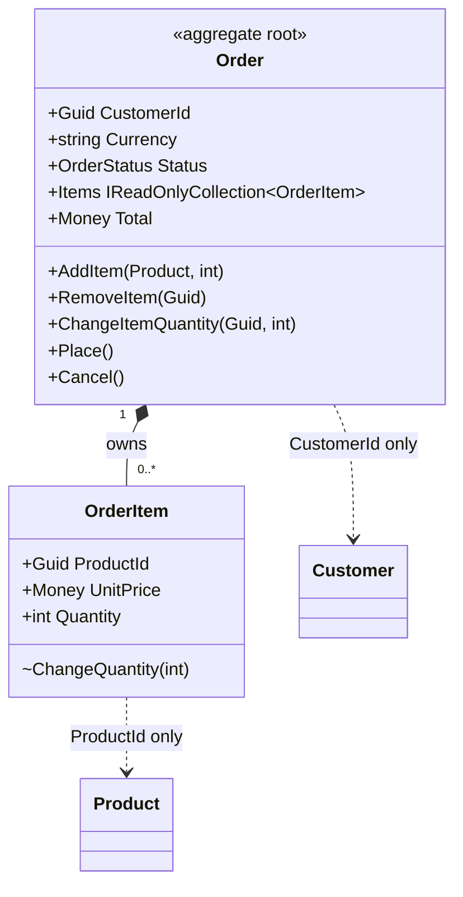

# Day 01: Aggregate (Order)

## 1. Why this pattern was needed here

An order is not one object. It is an `Order` plus a list of `OrderItem`s, and the rules span both:
- Lines can only change while the order is a draft.
- All lines share the order's currency.
- Only active products can be added.
- A line holds at most 99 units, and adding the same product twice merges the lines.
- An empty order cannot be placed.

The naive shape exposes the list:

```csharp
// naive: what ShopFlows would look like without an aggregate root
public class Order { public List<OrderItem> Items = new(); public string Status; }

order.Items.Add(new OrderItem { Quantity = 500, Currency = "EUR" }); // in a USD order
order.Items[0].Quantity = -3;                                        // after it was placed
```

Each caller (controller, cart service, admin tool) would have to remember every rule. One forgotten check corrupts the order.

## 2. How the pattern works (core concept)

An **Aggregate** is a cluster of objects that change together and must stay consistent as a unit. One entity is the **aggregate root**.
- Outside code holds references only to the root.
- All changes go through the root's methods, which enforce the invariants.
- Inner objects (the lines) are read-only to the outside world.
- Other aggregates are referenced by **Id**, not by object, which keeps the boundary small.
- The aggregate is loaded and saved as a whole.



A generic example unrelated to ShopFlows:

```csharp
public class Playlist
{
    private readonly List<string> _songs = [];
    public IReadOnlyList<string> Songs => _songs;

    public void Add(string song)
    {
        if (_songs.Count == 100) throw new InvalidOperationException("Playlist full");
        if (_songs.Contains(song)) return;   // no duplicates
        _songs.Add(song);
    }
}
```

## 3. How it is implemented in this project

**Files:** `src/ShopFlows.Domain/Orders/Order.cs` (the root), `OrderItem.cs`, and `OrderStatus.cs`.

The list is private. The outside world sees a read-only view:

```csharp
private readonly List<OrderItem> _items = [];
```
```csharp
public IReadOnlyCollection<OrderItem> Items => _items.AsReadOnly();
```

`OrderItem` has an `internal` constructor and an `internal void ChangeQuantity(int quantity)`. Code outside `ShopFlows.Domain` cannot create or modify a line, so `Order` is the only gate.

`AddItem` shows the invariants in one place:

```csharp
public void AddItem(Product product, int quantity)
{
    EnsureDraft();
    EnsurePositive(quantity);

    if (!product.IsActive)
        throw new DomainException($"Product '{product.Name}' is not available.");
    if (product.Price.Currency != Currency)
        throw new DomainException($"Product is priced in {product.Price.Currency} but the order uses {Currency}.");

    var existing = FindItem(product.Id);
    if (existing is not null)
    {
        var merged = existing.Quantity + quantity;
        EnsureWithinLimit(merged);
        existing.ChangeQuantity(merged);
        return;
    }

    EnsureWithinLimit(quantity);
    _items.Add(new OrderItem(product.Id, product.Name, product.Price, quantity));
}
```

Notice that the item stores `product.Id`, a name, and a price snapshot. It never stores the `Product` object, so the Catalog stays a separate aggregate.

The lifecycle is guarded by `EnsureDraft()` (used by `AddItem`, `RemoveItem`, `ChangeItemQuantity`, and `Place`). `Place()` also rejects empty orders, and `Cancel()` rejects an order that is already cancelled. `ChangeItemQuantity(productId, 0)` removes the line. `Total` is computed from the lines, so it can never drift out of sync.

**DI:** none yet. A repository that loads and saves the whole aggregate arrives with persistence.

**Tests:** `tests/ShopFlows.UnitTests/Domain/Orders/OrderTests.cs`, for example:
- `AddItem_merges_same_product_into_one_line`
- `AddItem_rejects_merge_that_exceeds_line_limit`
- `AddItem_rejects_product_in_other_currency`
- `Placed_order_cannot_be_changed`
- `Items_cannot_be_modified_from_outside`

**Kata:** none for Day 1. It is foundation code.

**Connects to:** Catalog (`Product` is read when adding), Identity (`CustomerId`), and Common (`Money`, `Entity`, `DomainException`). Cart, Payments, Shipping, and Returns will later act on orders only through these methods.

## 4. Pros and cons

**Pros**
- Each rule is written once inside `Order`. Future controllers and handlers stay thin, because they call `order.AddItem(...)` and can't skip a check.
- Tests need no mocks or database. 25 order test cases run in milliseconds against plain objects.
- The unit price snapshot on `OrderItem` means a catalog price change never rewrites a customer's existing order.
- Referencing `Customer` and `Product` by Id keeps the order small and lets those aggregates evolve independently.

**Cons**
- Rules that need data from outside the aggregate (live stock levels, customer credit limits) cannot be enforced inside `Order` alone. They will need an application service or domain service.
- `internal` visibility is the only thing protecting `OrderItem`, so anything added to `ShopFlows.Domain` could still misuse it.
- EF Core will need configuration to map a private backing field (`_items`).
- Errors are exceptions for now. A result type or ProblemDetails mapping comes later.

## 5. When to use and when to avoid

**Use it when** several objects must change together under shared rules, such as an order and its lines, or a cart and its items, and you want one place that guarantees consistency.

**Avoid it when** an object has no invariants spanning other objects (a `Category` is just an entity). Also avoid it when you are tempted to make huge aggregates "because they are related". Large aggregates cause locking and loading pain.

**Closest alternative: Transaction Script** (a service method that loads rows and applies rules procedurally). Choose Transaction Script for simple CRUD-like operations with few rules, and an Aggregate when the same invariants must hold no matter which use case touches the data.
