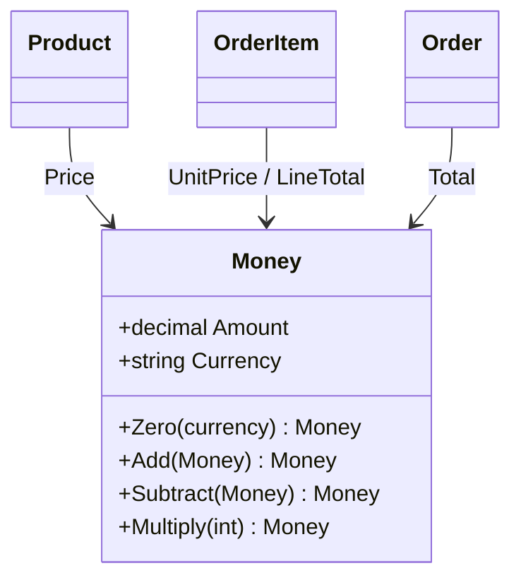

# Day 01: Value Object (Money)

## 1. Why this pattern was needed here

Every product has a price, and every order has line totals and a grand total. The naive shape is two loose primitives:

```csharp
// naive: what ShopFlows would look like without Money
public class Product { public decimal Price; public string Currency; }

var total = 0m;
foreach (var line in lines)
    total += line.Price * line.Quantity;   // what if one line is EUR and another USD?
```

The pain:
- Nothing stops `Price = -5`.
- The currency is easy to forget or mistype (`"usd"`, `"US$"`).
- Adding USD to EUR compiles and quietly produces garbage.
- The same checks would be copied into Product, Order, Cart, Pricing, and so on.

## 2. How the pattern works (core concept)

A **Value Object** is a small object defined only by its values, not by an identity.
- **Immutable**: operations return a new instance instead of changing the existing one.
- **Self-validating**: the constructor rejects invalid state, so an invalid instance can never exist.
- **Equality by value**: two instances with the same data are equal.
- **Behavior lives with the data**: arithmetic and rules sit on the type itself.



A generic example unrelated to ShopFlows:

```csharp
public sealed record Temperature
{
    public Temperature(double celsius)
    {
        if (celsius < -273.15) throw new ArgumentOutOfRangeException(nameof(celsius));
        Celsius = celsius;
    }
    public double Celsius { get; }
    public Temperature Warmer(double by) => new(Celsius + by);
}

new Temperature(20) == new Temperature(20); // true: equal by value
```

A C# `record` gives value equality (`Equals`, `GetHashCode`, `==`) for free. Read-only properties and a validating constructor provide the rest.

## 3. How it is implemented in this project

**File:** `src/ShopFlows.Domain/Common/Money.cs`, class `Money`

It is a `sealed record` with get-only properties. The constructor validates both parts:

```csharp
public Money(decimal amount, string currency)
{
    if (amount < 0)
        throw new DomainException("Money amount cannot be negative.");

    Currency = NormalizeCurrency(currency);
    Amount = amount;
}
```

`NormalizeCurrency` trims and upper-cases the code, then requires exactly three ASCII letters, so `" usd "` becomes `"USD"`.

Every arithmetic method returns a **new** `Money`. Every binary operation goes through one currency guard:

```csharp
public Money Add(Money other)
{
    EnsureSameCurrency(other);
    return new Money(Amount + other.Amount, Currency);
}
```

```csharp
private void EnsureSameCurrency(Money other)
{
    if (other.Currency != Currency)
        throw new DomainException($"Currency mismatch: {Currency} vs {other.Currency}.");
}
```

`Subtract` also refuses to go below zero, and `Multiply(int quantity)` refuses negative quantities. Because results are built with `new Money(...)`, the constructor rules also apply to every result.

**Where it is used:**
- `Product.Price` (`src/ShopFlows.Domain/Catalog/Product.cs`). `ChangePrice` additionally rejects a currency switch and zero prices.
- `OrderItem.UnitPrice` and `OrderItem.LineTotal => UnitPrice.Multiply(Quantity)`
- `Order.Total`, which folds the lines starting from `Money.Zero(Currency)`:

```csharp
public Money Total => _items.Aggregate(Money.Zero(Currency), (sum, item) => sum.Add(item.LineTotal));
```

**DI:** none. Value objects are created with `new`, not resolved from a container.

**Tests:** `tests/ShopFlows.UnitTests/Domain/Common/MoneyTests.cs` covers:
- currency normalization and invalid codes
- rejecting negative amounts
- Add and Subtract with the same currency, and mismatches
- Multiply
- that operations do not mutate the original
- `Equality_is_by_value`

**Kata:** none for Day 1. Per the day's scope, Money was built straight into the domain as foundation code. `PatternKatas/` exists, ready for later days.

**Connects to:** Catalog (product prices), Orders (line and order totals). Later, Pricing, Cart, Payments, and Returns will all take and return `Money` instead of `decimal`.

## 4. Pros and cons

**Pros**
- A negative price or a currency like `"US$"` cannot exist anywhere in ShopFlows, because the constructor is the only way in.
- `Order` relies on `Money.Add` to block cross-currency totals, and also checks the product currency up front for a clearer error message.
- Tests compare money with `.Should().Be(new Money(25m, "USD"))` instead of checking two fields.
- Instances are immutable, so `OrderItem` can safely keep the `Money` instance it received from `Product`, and a later `Product.ChangePrice` does not affect existing orders (see `Item_keeps_price_captured_when_added`).

**Cons**
- Every operation allocates a new object. That's negligible here, but worth knowing if a report ever sums millions of rows in memory.
- `Money` cannot represent negative amounts, so refunds or discounts that go below zero will need a separate concept or an explicit rule change later.
- `Multiply` takes `int`. Percentage-based rules in the Pricing feature will need a new method such as `Multiply(decimal factor)` with a rounding policy.
- EF Core will need an owned-type mapping for it when persistence arrives.

## 5. When to use and when to avoid

**Use it when** a concept is fully described by its values, has rules about what is valid, and is passed around a lot. Money, email address, SKU, date range, and address are good examples.

**Avoid it when** the thing has a lifecycle and must be tracked over time even as its data changes (a Customer, an Order). Also avoid it when the value is a bare number with no invariants, where wrapping it only adds ceremony.

**Closest alternative: Entity.** Pick an Entity when two objects with identical data are still *different things* (two customers named "Ada"). Pick a Value Object when identical data means *the same thing* (two `10.00 USD`).
